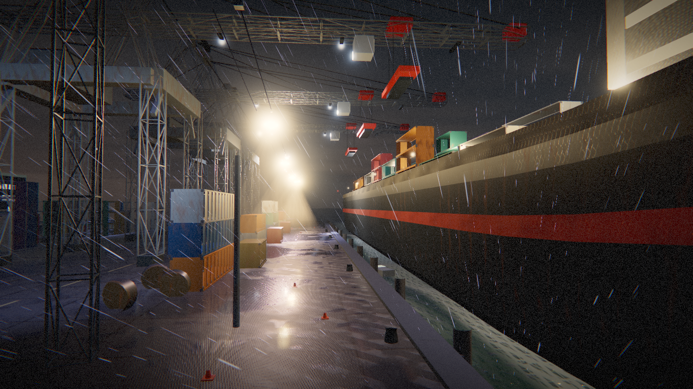
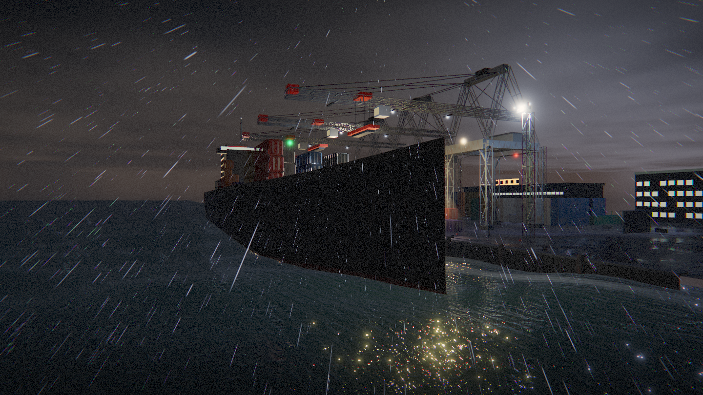

# Terminal 09 — a rainy night on a container terminal

A procedurally generated, real-time 3D scene: a modern container ship berth at night in
heavy rain. Moored ship, ship-to-shore gantry cranes, stacked containers, swaying work
lamps, wet quay, open sea, reflections, rain, fog and bloom.




Everything is generated at load time. **There are no image, model, font or audio assets**,
and there is no 3D library: the engine is hand-written WebGL2 + GLSL ES 3.0.

```
index.html      single page shell + UI overlay
styles.css
src/engine/     math, GL wrapper, shader assembler, procedural meshes, camera, renderer
src/scene/      terminal layout, containers, cranes, ship, quay, lamps, sea, rain
src/shaders/    GLSL chunks and per-effect shaders
tools/shot.mjs  dev-only: headless screenshots for visual regression (needs playwright-core)
```

## Run it locally

Any static file server works. ES modules need HTTP (not `file://`):

```bash
python -m http.server 8080
# then open http://localhost:8080
```

## Deploy to GitHub Pages

The site is pure static files with relative paths, so it works at a domain root or under a
subpath such as `https://<user>.github.io/<repo>/`.

```bash
git init
git add .
git commit -m "Terminal 09"
git remote add origin https://github.com/<user>/<repo>.git
git push -u origin main
```

Then in the repository: **Settings → Pages → Build and deployment → Deploy from a branch →
`main` / `/ (root)`**. Nothing to build. `node_modules/` and `shots/` are not needed on the
server; `.gitignore` keeps them out.

## Controls

| Input | Action |
| --- | --- |
| `H` | hide / show the UI |
| `F` | toggle free-fly camera |
| `R` | reset to the cinematic camera |
| `Space` | pause time |
| `W A S D`, `Q E`, `Shift` | fly (free camera, click the canvas to capture the mouse) |
| panel | rain intensity, wind, exposure, fog volume, lens rain, camera, quality |

URL overrides for sharing a still frame:

```
?paused=1&t=12&shot=2&nolens=1&exp=0.35
  t=<seconds>    start time        shot=<0..4>  cinematic shot index
  eye=x,y,z look=x,y,z  manual camera
  rain=0..1  wind=0..1  exp=<EV>    nobloom, nofog, norain, norefl, nodetail, nolens, quality=low|medium|high
```

## How it is built

**Frame graph** (all custom, one `requestAnimationFrame` loop):

1. **Planar reflection, quay** — camera mirrored about `y = 0`, scene rendered at 0.55×
   into an RGBA16F target with mip storage; geometry below the mirror plane is clipped in
   the fragment shader.
2. **Planar reflection, sea** — same, mirrored about sea level, 0.45×.
3. **Forward HDR pass** — MSAA 4×, 40-light array shading (point + spot), ACES-ready linear
   values into RGBA16F.
4. **Bloom** — 6-level down/up pyramid with a soft-knee threshold.
5. **Composite** — ACES tonemap, film grade, chromatic aberration, vignette, grain, lens
   droplets, gamma.

**Lighting** — `shadeSurface()` in `src/shaders/lib.js`: Cook–Torrance GGX with Smith
visibility, hemisphere ambient, wet-bounce ambient, a dim overcast moon term, and a
radius-windowed inverse-square point/spot loop over 40 lights.

**Wet ground** — puddle mask from fbm, Fresnel-weighted planar reflection sampled with a
roughness-driven mip level and a vertical smear (the classic wet-road streak), animated
expanding rain rings as normal perturbation, procedural slab joints and lane paint.

**Sea** — 5-term Gerstner swell in the vertex shader with analytic normals, wind-scrolled
detail chop, rain pocking, Fresnel planar reflection, foam bands at the quay and hull,
height fog blending into the sky.

**Swaying lamps** — cable-hung work lamps on a catenary between two masts. Each lamp is a
rigid body swinging about its pivot with a wind gust envelope; the light source, glow
sprite, volumetric cone and reflected image all read from the same transform.

**Geometry** — an immediate-mode builder (`src/engine/mesh.js`) with boxes, cylinders,
lathes, swept tubes, sagging catenaries and winding-corrected quads. The whole static
terminal is baked once into a single interleaved vertex buffer (position, normal, UV,
albedo, roughness/metal/detail/AO, emissive) — two draw calls for ~140k triangles.

**Sky** — fbm overcast deck projected on a cloud plane, light pollution from the terminal,
moon disc smeared by cloud, all matching the fog colour at the horizon. Distant lightning
lifts the clouds and the ambient every 40–90 seconds.

## Performance

Quality presets scale render resolution, MSAA, rain count, bloom levels and reflection
resolution. The loop measures FPS and nudges an internal resolution multiplier between
0.62 and 1.0 to hold ~60 fps. On an integrated AMD Radeon PRO (headless Chromium, D3D11)
the scene holds 60 fps at 1440×810 on **HIGH**; a 1080p panel with a mid-range GPU should
use **MEDIUM**.

## Browser support

Requires WebGL2 (Chrome/Edge 56+, Firefox 51+, Safari 15+). `EXT_color_buffer_float` is used
for HDR targets; without it the renderer falls back to 8-bit targets and loses some bloom
range.

MIT licensed. No third-party code or assets.
